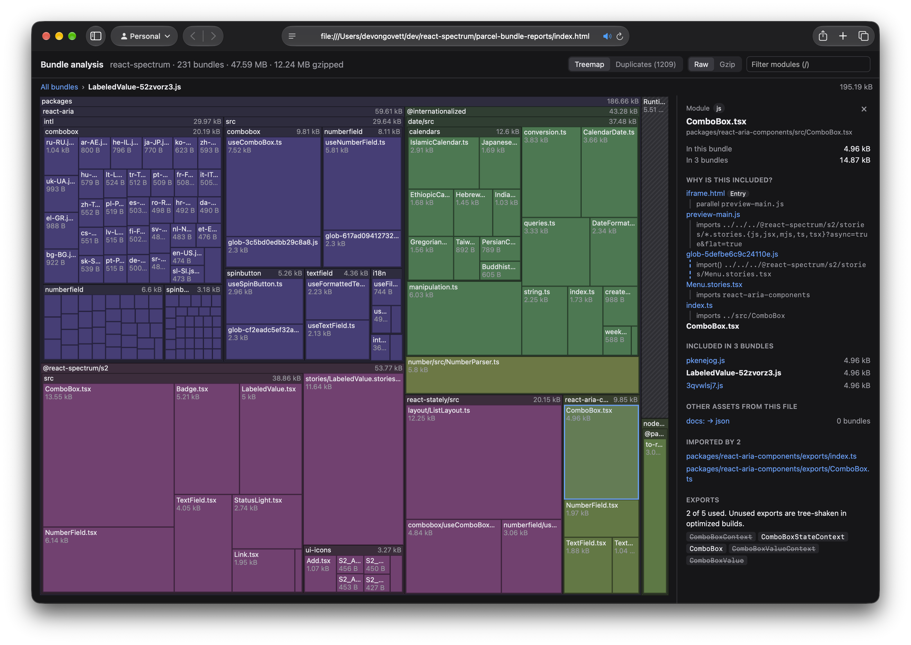

Today we're releasing the first alpha of Parcel 3, a ground up rewrite of Parcel in Rust. It is up to 100x faster than v2, and supports native plugins written in Rust, Go, Swift, or C, as well as a custom runtime for JavaScript and TypeScript plugins. It also includes improved automatic code splitting, library mode, tree shaking, centralized configuration, and much more.

## Why a rewrite?

In Parcel v2, we rewrote several individual pieces of Parcel in Rust. First was our [JavaScript compiler](/blog/beta3/), built on top of SWC. Then, we built [Lightning CSS](https://lightningcss.dev/). Later, we [rebuilt](/blog/v2-15-0/) our HTML and SVG transformer and optimizers. However, Parcel's core was still written in JavaScript. This limited our maximum possible performance due to lack of shared memory between threads, high memory usage, garbage collection, and the cost of serializing values between workers and languages.

Parcel v3 is an entirely self-contained Rust binary, with no dependency on Node at all. Everything from the CLI and dev server, to the transformers, bundler, optimizers, and everything in between is now fully native. This enables us to efficiently take full advantage of modern multi-core hardware. The results speak for themselves: up to **100x faster builds** using the same underlying compilers as v2, only changing the core.

## Performance

Let's cut to the benchmarks. Here's a comparison of cold development builds between v2 and v3 for [React Spectrum](https://github.com/adobe/react-spectrum), a large TypeScript monorepo. For reference:

* **Storybook**: ~100 entries, JS [macros](/features/macros/), custom plugins [ported](https://github.com/parcel-bundler/storybook/tree/parcel3/crates) to Rust for Parcel 3.
* **Docs website**: ~340 pages, React Server Components, MDX, Tailwind, custom plugins.
* **Library build**: ~160 packages, TSX, macros, CSS modules, SVG icons. Outputs over 14,000 files.

### Development build time

<svg class="bench-chart" viewBox="0 0 560 282" style="width: 100%; max-width: 560px; display: block; margin: 1.5em 0" role="img" aria-labelledby="time-title time-desc">
  <title id="time-title">Cold development build time, Parcel 2 vs Parcel 3</title>
  <desc id="time-desc">Storybook: Parcel 2 16.62s, Parcel 3 572ms (29× faster). Docs website: Parcel 2 87.59s, Parcel 3 810ms (108× faster). Library build: Parcel 2 131.47s, Parcel 3 2.71s (49× faster).</desc>
  <style>
    .bench-chart { font-family: system-ui, -apple-system, "Segoe UI", sans-serif; --bench-v2: #2a78d6; --bench-v3: #eb6834; }
    html.dark .bench-chart { --bench-v2: #3987e5; --bench-v3: #d95926; }
    .bench-chart text { fill: currentColor; }
    .bench-chart .bench-v2 { fill: var(--bench-v2); }
    .bench-chart .bench-v3 { fill: var(--bench-v3); }
    .bench-chart .bench-label { font-size: 15px; font-weight: 600; }
    .bench-chart .bench-value, .bench-chart .bench-legend { font-size: 13px; font-variant-numeric: tabular-nums; }
    .bench-chart .bench-value { opacity: 0.75; }
    .bench-chart .bench-speedup { font-weight: 600; }
    .bench-chart .bench-axis { stroke: currentColor; stroke-opacity: 0.25; }
  </style>
  <text x="0" y="14" class="bench-label">Storybook</text>
  <line class="bench-axis" x1="0.5" y1="20" x2="0.5" y2="66" />
  <path class="bench-v2" d="M0 22H54.2a4 4 0 0 1 4 4V38a4 4 0 0 1 -4 4H0Z"><title>Storybook – Parcel 2: 16.62s</title></path>
  <text x="64.2" y="37" class="bench-value">16.62s</text>
  <path class="bench-v3" d="M0 44H0.0a4 4 0 0 1 4 4V60a4 4 0 0 1 -4 4H0Z"><title>Storybook – Parcel 3: 572ms (29× faster)</title></path>
  <text x="10.0" y="59" class="bench-value">572ms · <tspan class="bench-speedup">29× faster</tspan></text>
  <text x="0" y="104" class="bench-label">Docs website</text>
  <line class="bench-axis" x1="0.5" y1="110" x2="0.5" y2="156" />
  <path class="bench-v2" d="M0 112H302.5a4 4 0 0 1 4 4V128a4 4 0 0 1 -4 4H0Z"><title>Docs website – Parcel 2: 87.59s</title></path>
  <text x="312.5" y="127" class="bench-value">87.59s</text>
  <path class="bench-v3" d="M0 134H0.0a4 4 0 0 1 4 4V150a4 4 0 0 1 -4 4H0Z"><title>Docs website – Parcel 3: 810ms (108× faster)</title></path>
  <text x="10.0" y="149" class="bench-value">810ms · <tspan class="bench-speedup">108× faster</tspan></text>
  <text x="0" y="194" class="bench-label">Library build</text>
  <line class="bench-axis" x1="0.5" y1="200" x2="0.5" y2="246" />
  <path class="bench-v2" d="M0 202H456.0a4 4 0 0 1 4 4V218a4 4 0 0 1 -4 4H0Z"><title>Library build – Parcel 2: 131.47s</title></path>
  <text x="466.0" y="217" class="bench-value">131.47s</text>
  <path class="bench-v3" d="M0 224H5.5a4 4 0 0 1 4 4V240a4 4 0 0 1 -4 4H0Z"><title>Library build – Parcel 3: 2.71s (49× faster)</title></path>
  <text x="15.5" y="239" class="bench-value">2.71s · <tspan class="bench-speedup">49× faster</tspan></text>
  <rect class="bench-v2" x="0" y="268" width="12" height="12" rx="2" />
  <text x="18" y="278.5" class="bench-legend">Parcel 2</text>
  <rect class="bench-v3" x="96" y="268" width="12" height="12" rx="2" />
  <text x="114" y="278.5" class="bench-legend">Parcel 3</text>
</svg>

### Memory usage

<svg class="bench-chart" viewBox="0 0 560 282" style="width: 100%; max-width: 560px; display: block; margin: 1.5em 0" role="img" aria-labelledby="memory-title memory-desc">
  <title id="memory-title">Memory usage, Parcel 2 vs Parcel 3</title>
  <desc id="memory-desc">Storybook: Parcel 2 7.7GB, Parcel 3 1.5GB (5.1× less). Docs website: Parcel 2 13.9GB, Parcel 3 2.1GB (6.6× less). Library build: Parcel 2 5.7GB, Parcel 3 2.3GB (2.5× less).</desc>
  <style>
    .bench-chart { font-family: system-ui, -apple-system, "Segoe UI", sans-serif; --bench-v2: #2a78d6; --bench-v3: #eb6834; }
    html.dark .bench-chart { --bench-v2: #3987e5; --bench-v3: #d95926; }
    .bench-chart text { fill: currentColor; }
    .bench-chart .bench-v2 { fill: var(--bench-v2); }
    .bench-chart .bench-v3 { fill: var(--bench-v3); }
    .bench-chart .bench-label { font-size: 15px; font-weight: 600; }
    .bench-chart .bench-value, .bench-chart .bench-legend { font-size: 13px; font-variant-numeric: tabular-nums; }
    .bench-chart .bench-value { opacity: 0.75; }
    .bench-chart .bench-speedup { font-weight: 600; }
    .bench-chart .bench-axis { stroke: currentColor; stroke-opacity: 0.25; }
  </style>
  <text x="0" y="14" class="bench-label">Storybook</text>
  <line class="bench-axis" x1="0.5" y1="20" x2="0.5" y2="66" />
  <path class="bench-v2" d="M0 22H250.8a4 4 0 0 1 4 4V38a4 4 0 0 1 -4 4H0Z"><title>Storybook – Parcel 2: 7.7GB</title></path>
  <text x="260.8" y="37" class="bench-value">7.7GB</text>
  <path class="bench-v3" d="M0 44H45.6a4 4 0 0 1 4 4V60a4 4 0 0 1 -4 4H0Z"><title>Storybook – Parcel 3: 1.5GB (5.1× less)</title></path>
  <text x="55.6" y="59" class="bench-value">1.5GB · <tspan class="bench-speedup">5.1× less</tspan></text>
  <text x="0" y="104" class="bench-label">Docs website</text>
  <line class="bench-axis" x1="0.5" y1="110" x2="0.5" y2="156" />
  <path class="bench-v2" d="M0 112H456.0a4 4 0 0 1 4 4V128a4 4 0 0 1 -4 4H0Z"><title>Docs website – Parcel 2: 13.9GB</title></path>
  <text x="466.0" y="127" class="bench-value">13.9GB</text>
  <path class="bench-v3" d="M0 134H65.5a4 4 0 0 1 4 4V150a4 4 0 0 1 -4 4H0Z"><title>Docs website – Parcel 3: 2.1GB (6.6× less)</title></path>
  <text x="75.5" y="149" class="bench-value">2.1GB · <tspan class="bench-speedup">6.6× less</tspan></text>
  <text x="0" y="194" class="bench-label">Library build</text>
  <line class="bench-axis" x1="0.5" y1="200" x2="0.5" y2="246" />
  <path class="bench-v2" d="M0 202H184.6a4 4 0 0 1 4 4V218a4 4 0 0 1 -4 4H0Z"><title>Library build – Parcel 2: 5.7GB</title></path>
  <text x="194.6" y="217" class="bench-value">5.7GB</text>
  <path class="bench-v3" d="M0 224H72.1a4 4 0 0 1 4 4V240a4 4 0 0 1 -4 4H0Z"><title>Library build – Parcel 3: 2.3GB (2.5× less)</title></path>
  <text x="82.1" y="239" class="bench-value">2.3GB · <tspan class="bench-speedup">2.5× less</tspan></text>
  <rect class="bench-v2" x="0" y="268" width="12" height="12" rx="2" />
  <text x="18" y="278.5" class="bench-legend">Parcel 2</text>
  <rect class="bench-v3" x="96" y="268" width="12" height="12" rx="2" />
  <text x="114" y="278.5" class="bench-legend">Parcel 3</text>
</svg>

### Speed without caching

In Parcel 2, we heavily invested in disk caching and incremental builds. In general, caching and memoization are effective when the underlying code is slow (as with JavaScript-based bundlers). However, when cold builds are fast in the first place, caching becomes much less necessary, and not only that, may actually become a bottleneck. Keeping track of all of the possible files, environment variables, options, configs, etc. that need to invalidate the cache has significant overhead, and also leads to a large number of bugs.

Parcel 3 uses a significantly simpler architecture, optimizing for the fastest possible cold builds rather than paying for the overhead of caching. We still support incremental in-memory rebuilds, but don't need to write each transformation result to disk, or perfectly track all possible invalidations. For changes that may cause non-deterministic results like plugins or configuration, Parcel 3 is fast enough to simply do a full rebuild. This eliminates an entire class of stale-cache bugs.

## Batteries included

In Parcel 2, we split each piece into plugins as individual npm packages. This was a very modular architecture, but resulted in hundreds of dependencies that you needed to upgrade and maintain.

In Parcel 3, support for most common web languages are included out of the box in a single binary, including HTML, CSS, JavaScript, TypeScript, SVG, image conversion and optimization, RSS and Atom feeds, web manifests, and more. Newly added is native support for Tailwind (without PostCSS), React Compiler, MDX, SVG  → JSX, and glob imports.

The Parcel development experience has major improvements too. It includes support for trusted HTTPS via a local certificate authority that integrates with your operating system, an improved `--open` option that reuses your existing browser tab on macOS via Apple Events, and a built-in bundle analyzer that shows why each module is included, which bundles load others, and much more.



The new `parcel run` command builds and runs a Node.js entry with hot module replacement, only restarting the process if needed. This is perfect for developing React Server Components or any other Node server or script.

Even with all of these features as well as an entire built-in JavaScript runtime ([see below](#javascript-plugins)), the Parcel 3 binary is less than 30 MB with zero npm dependencies. This is 4x smaller than Parcel 2, whose total install size (including dependencies) was ~120 MB.

## Native plugins

Aside from these built-in features, Parcel 3 is extensible via [native plugins](/plugin-system/native-plugins/) written in Rust, Go, Swift, or any language that supports the C [ABI](https://en.wikipedia.org/wiki/Application_binary_interface). This enables anyone to extend Parcel to support new languages, customize module resolution, optimize bundles, etc., all with native performance.

Native Parcel plugins are [dynamic libraries](https://en.wikipedia.org/wiki/Dynamic_library) loaded into the Parcel process at runtime. Parcel exposes a stable C ABI with functions plugins can call to get and set asset content, read the bundle graph, and [much more](https://github.com/parcel-bundler/parcel/blob/v3/crates/parcel-plugin-abi/plugin.h).

```c
bool parcel_asset_get_content(struct Buffer *buf, AssetRef asset, Options options, Diagnostics *diagnostics);
void parcel_asset_set_content(Asset asset, const uint8_t *data, uintptr_t len, const uint8_t *map, uintptr_t map_len);
void parcel_asset_set_type(Asset asset, const uint8_t *ty, uintptr_t ty_len);
// ...
```

C is the lingua franca of programming languages: it is low level, has a stable ABI, and many higher level languages are interoperable with it. We've built SDKs for [Rust](/plugin-system/native-plugins/#rust), [Go](/plugin-system/native-plugins/#go), and [Swift](/plugin-system/native-plugins/#swift), as well as a reusable [GitHub Actions workflow](/plugin-system/native-plugins/#publishing) to manage cross-compilation and publishing to npm.



```rust
use parcel_plugin::{Asset, Diagnostic, Options, Plugin, register_plugin};

struct MyTransformer;

impl Plugin for MyTransformer {
  fn new(_config: &[u8]) -> Result<Self, Diagnostic> {
    Ok(MyTransformer)
  }

  fn transform(&self, asset: &mut Asset, _options: &Options) -> Result<(), Diagnostic> {
    let source = asset.content()?;
    let code = compile(&source);
    asset.set_content(code);
    Ok(())
  }
}

register_plugin!(MyTransformer);
```

```go
package main
import parcel "github.com/parcel-bundler/parcel/plugin-go/v3"

type MyTransformer struct{}

func (t *MyTransformer) Transform(asset *parcel.Asset, _ *parcel.Options) error {
	source, err := asset.Content()
	if err != nil {
		return err
	}

	code := compile(source)
	asset.SetContent(code)
	return nil
}

func init() {
	parcel.RegisterPlugin(func(config []byte) (any, error) {
		return &MyTransformer{}, nil
	})
}

func main() {}
```

```swift
import ParcelPlugin

struct MyTransformer: Transformer {
  init(config: NoConfig) {}

  func transform(_ asset: Asset, options: Options) async throws {
    let source = try asset.content()
    let code = compile(source)
    asset.setContent(code)
  }
}

#parcelPlugin(MyTransformer.self)
```



## JavaScript plugins

Native plugins are great for high performance, but for simple or infrequently called plugins, Parcel 3 supports plugins written in JavaScript or TypeScript as well. However, since Parcel 3 is a standalone native binary with no dependency on Node, we took a different approach.

Parcel 3 has a custom embedded JavaScript runtime for plugins and [macros](/features/macros/) built on top of the [QuickJS](https://bellard.org/quickjs/) engine. It includes partial Node compatibility for [most features](/plugin-system/authoring-plugins/#javascript-runtime) commonly used by build plugins, but intentionally lacks things like network access. While its peak performance is not on par with v8, QuickJS starts up very quickly, has a small memory footprint, and can be easily embedded and run on multiple threads in parallel.

When maximum performance is needed, we recommend writing native plugins. For plugins that run infrequently (e.g. only on a few files), QuickJS is plenty fast. JavaScript plugins are mostly compatible with Parcel v2, but there are some minor API differences. See the [migration guide](/migration/parcel-2/#plugins-1) for more details.

## Centralized configuration

In Parcel 2, we added support for the `.parcelrc` configuration file. This allowed configuring which plugins Parcel ran, but configuring those plugins themselves was scattered throughout your project in files like `.babelrc`, `.postcssrc`, `package.json`, and more.

In Parcel 3, we're centralizing plugin configuration in `.parcelrc` as well. This not only makes it easier to find, it also improves performance because all configuration is resolved once at the start of the build rather than constantly searching the file system.

```json/4-9
{
  "extends": "@parcel/config-default",
  "bundler": {
    "plugin": "@parcel/bundler-default",
    "config": {
      "minBundleSize": 30000,
      "manualSharedBundles": [
        {"assets": ["node_modules/**"]}
      ]
    }
  }
}
```

## Smarter bundling

In Parcel 3, we've also significantly improved our bundling algorithm, which is responsible for creating optimal code split chunks. Compared with v2 on a site with 450 pages:

* 64% fewer HTTP requests per page
* 10% less transferred bytes per page

This is achieved through an improved bundle merging cost model, which balances parallel request count, Brotli compressed size, and cache reuse within a user session and between builds. These parameters are also [tunable](/features/code-splitting/#configuration) for your specific application's needs. We'll write more about how this works in a future post.

Parcel 3 is also much more careful about CSS ordering correctness than before. CSS code splitting is challenging because extracting a shared CSS file changes the cascade order. Parcel 3 now only does this when it is provably safe to do so through whole application analysis. You'll see a warning if stylesheets are imported in conflicting orders.

Tree shaking has also improved. In addition to ESM, CJS, and CSS modules, we also now support tree shaking for SVG. Parcel tracks which elements are used via hash references like `<use href="sprite.svg#icon"/>` and removes unused elements. For JavaScript, scope hoisting has been [removed](https://devongovett.me/blog/scope-hoisting.html), which reduces bug surface area while retaining most of the benefit of tree shaking, and enabling features like top-level await.

## Building libraries

Parcel is one of the easiest ways to build a library or an entire monorepo for distribution on npm, and it has been improved significantly in v3. Now, Parcel automatically reads the `package.json#exports` field, including nested and multi-entry packages, and builds every target in parallel.

In this example, a main entry point and a folder of utils are all compiled to both ESM and CJS just by running `parcel build`.

```json
{
  "name": "my-library",
  "exports": {
    ".": {
      "source": "./src/index.js",
      "import": "./dist/index.mjs",
      "require": "./dist/index.cjs"
    },
    "./utils/*": {
      "source": "./src/utils/*.js",
      "import": "./dist/utils/*.mjs",
      "require": "./dist/utils/*.cjs"
    }
  }
}
```

In addition, Parcel now outputs each module in a library to a separate output file rather than bundling so that consuming applications can tree shake and code split it more effectively.

TypeScript `.d.ts` generation is not yet supported but will be returning in a future release.

## Try it out

Install `parcel@next` to try out Parcel v3! You can also try it side-by-side with Parcel 2 by installing `@parcel/parcel3` and using the `parcel3` command. See the [migration guide](/migration/parcel-2/) for details on what you'll need to update in your project.

There are still a few features we're working on including compressor plugins, `.d.ts` generation, custom bundler plugins, a programmatic JavaScript API, and known issues. Please send your feedback on [GitHub](https://github.com/parcel-bundler/parcel/issues).
